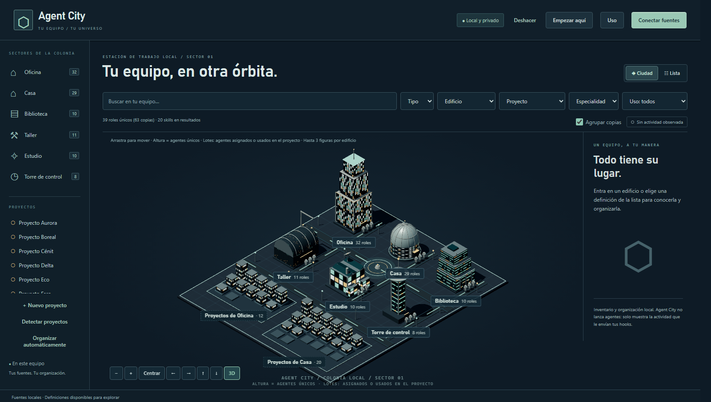

# Agent City



**Un mapa visual de todos tus agentes de IA y sus skills.** Encuentra, organiza y entiende lo que tienes instalado en Claude Code, Codex y otras herramientas, en una ciudad de ciencia ficción donde cada edificio agrupa a tus agentes. 100 % local, sin cuenta ni servidor externo. Licencia [MIT](LICENSE).

*English: a local-first visual map of every AI agent and skill installed on your machine (Claude Code, Codex and more). Find, organize and understand them in an isometric sci-fi city. No account, no cloud, no dependencies.*

## ¿Para qué sirve?

Cuando trabajas con agentes de IA, las definiciones se acumulan en carpetas ocultas de cada herramienta: cientos de agentes y skills, nombres repetidos entre herramientas, y ninguna forma de verlos juntos. Acabas sin saber qué tienes, qué hace cada cosa ni dónde está.

Agent City resuelve eso con un solo lugar:

- **Inventario único:** conecta las carpetas de tus herramientas (solo lectura) y ves todos tus agentes y skills juntos, con su procedencia y lo que cada archivo declara.
- **Búsqueda:** localiza al agente o skill que necesitas por nombre, especialidad, edificio o proyecto.
- **Organización propia:** coloca cada agente en un edificio (Taller, Estudio, Biblioteca, Torre de control) y asócialo a tus proyectos, para saber con quién cuentas en cada trabajo. Todo es reversible.
- **Actividad en vivo (opcional):** con unos hooks, los edificios se iluminan cuando una sesión de Claude Code o Codex está trabajando en un proyecto tuyo.

Es para quien usa varios agentes y skills y quiere orden y visibilidad. **No es** un ejecutor ni un orquestador de agentes: los personajes representan definiciones, no lanzan tareas, y la ciudad nunca modifica tus archivos.

## Arrancar en Windows

Necesitas Python 3.11 o posterior. No hay paquetes que instalar.

1. Abre **Iniciar.cmd** con doble clic. No deja ninguna ventana abierta: la ciudad se ejecuta en segundo plano.
2. El navegador abrirá **http://127.0.0.1:4317**. Si ya estaba en marcha, simplemente abre esa pestaña.
3. Para detenerla, abre **Detener.cmd**. Si la dejas en marcha, no pasa nada: consume muy poco y la actividad en vivo la necesita activa.

La ciudad es un pequeño servidor local, así que tiene que estar en marcha mientras la usas; solo que no necesita ventana. Si algo falla al arrancar, el motivo queda en `.local/agent-city.log`. Para verla con consola (útil al depurar), ejecuta `python -m agent_city --open`.

También puedes ejecutar `./Iniciar.ps1` desde PowerShell (también arranca sin ventana). Si la política de PowerShell impide abrir scripts, utiliza `Iniciar.cmd`; no es necesario cambiar la política del sistema.

Los lanzadores buscan Python con el lanzador `py` de Windows (3.13, 3.12, 3.11 o 3.14) y, si no existe, con `python`. Así funcionan aunque el `PATH` de Windows esté incompleto, algo habitual cuando se han instalado varias versiones de Python. Si no encuentran ninguna, lo dicen y esperan una tecla.

Los lanzadores guardan los datos en `.local/` dentro del proyecto. Puedes cambiar el puerto o la carpeta de datos:

```powershell
python -m agent_city --port 4318 --data-dir .local --open
```

Sin `--data-dir`, el módulo utiliza una carpeta dedicada de datos del usuario. Elige siempre el mismo directorio para recuperar la misma organización.

## Primer recorrido

1. **Conectar fuentes:** elige una sugerencia o introduce una carpeta concreta. Selecciona Roles o Skills y pulsa **Autorizar e importar**. Elegir una sugerencia solo rellena el formulario.
2. **Lista:** busca una definición y consulta su descripción y procedencia. Las copias de un mismo agente o skill (mismo nombre en Codex y en Claude Code, o en varias carpetas) se agrupan en una fila con una marca «×N» y sus orígenes; cada copia mantiene su identidad, su ruta y sus asignaciones, y la ficha las lista en «Copias».
3. **Asignar edificio o proyecto:** coloca un agente en uno o varios espacios. Oficina y Casa son contextos de proyecto; Taller y Estudio agrupan especialidades. Las asignaciones explícitas permiten encontrar un proyecto dentro de su taller.
4. **Vincular skill:** añade las habilidades que quieras relacionar con un agente. Son vínculos de organización personal, no una comprobación de compatibilidad operativa.
5. **Ciudad:** entra en un edificio, selecciona un robot y consulta sus skills. La Biblioteca también permite explorar el catálogo completo sin asignar cada habilidad a un agente.

¿Primera vez? Pulsa **Empezar aquí** en la cabecera: una guía de pocos pasos explica qué es la ciudad, qué son los edificios, agentes y skills, y cómo conectarlos. Se abre sola la primera vez si aún no has conectado ninguna fuente.

La búsqueda distingue tipos, edificios, proyectos y especialidades declaradas en las fuentes. Normaliza mayúsculas y acentos. La vista de lista permite acceder a todos los elementos aunque el mapa solo muestre hasta tres personajes por edificio. Puedes acercar, alejar, desplazar y centrar el mapa.

## Copias agrupadas y contadores

Un mismo agente o skill suele existir varias veces: en Codex y en Claude Code, o en varias carpetas. Agent City las agrupa por tipo y nombre (sin distinguir mayúsculas, acentos ni separadores: «UX Researcher», «ux-researcher» y «UX_researcher» son el mismo). Los números cuentan agentes y skills únicos y muestran las copias aparte, por ejemplo «145 roles únicos (229 copias)»; si no hay repetidos, solo el número. Lo mismo vale para las insignias de los edificios, las estadísticas de cada sala y la etiqueta del edificio en la ciudad, que muestra el total real de roles aunque solo se dibujen tres figuras.

- **«Agrupar copias»:** el interruptor junto al contador de resultados (activado por defecto, se recuerda entre sesiones) pasa a la lista plana con todas las copias.
- **Ficha, «Copias (N)»:** cada copia con su origen, su ruta relativa y una etiqueta respecto a la copia principal: «mismos metadatos declarados» o «metadatos distintos». Se compara la cabecera que declara cada archivo, no su contenido: dos copias con los mismos metadatos pueden diferir en el cuerpo. Un clic abre esa copia.
- **Salas:** una tarjeta por agente único, con «×N» y los orígenes; el tooltip lista el origen y la ruta de cada copia. La copia principal es la primera con descripción.
- La agrupación se calcula en el navegador a partir del catálogo: no cambia lo guardado ni los archivos, y cada copia conserva su propio identificador, asignaciones y vínculos.

Las asignaciones y los vínculos persisten tras reiniciar. **Deshacer** recupera cambios recientes de organización. Actualizar una fuente conserva la organización y distingue un archivo desaparecido de una lectura fallida.

## Poblar la ciudad en tres pasos

1. **Conectar todo lo encontrado:** en el panel de fuentes, la ciudad busca en tu equipo las carpetas de agentes y skills de Claude Code (incluidos los plugins instalados), Codex, `~/.agents`, Hermes, Gemini, ZCode y OpenClaw, y muestra cuántas definiciones hay en cada una. Marcas las que quieras, confirmas y se importan de una vez. Las fuentes que ya estaban conectadas se omiten, y un fallo en una no detiene las demás.
2. **Organizar automáticamente:** propone un edificio para cada agente único sin asignar según las palabras de su nombre, su especialidad y el inicio de su descripción (Estudio, Taller, Biblioteca o Torre de control). Se decide una vez por grupo de copias y todas las copias sin lugar van al mismo edificio, así que nunca se reparten entre edificios; si una copia ya estaba colocada, sus copias hermanas se proponen en ese mismo edificio («Copia de «X» ya colocada en…»). La lista muestra un agente por fila con «×N» y los recuentos como «N agentes únicos · M copias»; puedes desmarcar los que no te convenzan y aplicarlo. La propuesta nunca toca asignaciones existentes ni crea vínculos con skills. Todo es reversible con **Deshacer**. Es una heurística de palabras clave: revisa los motivos antes de aplicar.
3. **Detectar proyectos:** indica una carpeta (por ejemplo `C:\Proyectos`) y la ciudad lista sus subcarpetas. Eliges cuáles son proyectos y si pertenecen a Oficina o a Casa; se crean con su ruta, de modo que la actividad en vivo ilumine el edificio correcto. Solo lee los nombres de las carpetas.

Las carpetas que son enlaces o uniones (muy habituales en ZCode y OpenClaw, que apuntan a `~/.agents/skills`) no se siguen: sus skills entran por la carpeta original, sin duplicados.

## Fuentes y datos

Se admiten definiciones TOML de agentes de Codex, archivos `.md` de agentes de Claude Code y archivos `SKILL.md` con metadatos compatibles. El lector de cabeceras admite nombres/descripciones escalares y bloques de texto; no es un motor YAML general. No sigue `prompt_file`, no abre el cuerpo de los archivos Markdown, no abre notas enlazadas ni ejecuta instrucciones importadas. Los archivos originales permanecen intactos.

La ficha de cada definición muestra lo que el archivo declara (herramientas, modelo, invocación, versión, licencia, archivos hermanos), cada dato con su nivel: **Declarado** o **Verificado**. Un dato que no aparece se muestra como «No declarado», nunca como «no puede». Los roles de Codex no declaran modelo ni herramientas: los heredan del runtime que los ejecute.

Rutas habituales: `%USERPROFILE%\.codex\agents`, `%USERPROFILE%\.claude\agents`, `%USERPROFILE%\.agents\skills` y `%USERPROFILE%\.codex\skills`. También puedes añadir carpetas de skills de plugins explícitamente; conectar estas tres rutas no acredita un inventario exhaustivo de todos los plugins instalados.

Cada importación tiene límites: 2.000 definiciones, 20.000 entradas, profundidad 8 y 64 KiB por definición. Una exploración incompleta o fallida conserva la información anterior y muestra un aviso. Los archivos omitidos o incompatibles aparecen en los diagnósticos de la fuente.

`.local/`, las bases de datos, las sesiones y los archivos de agentes/skills importados **no se incluyen en Git**. El repositorio contiene aplicación, pruebas y documentación. La copia local de SQLite es una ayuda de recuperación; todavía no hay interfaz de restauración ni exportación portátil.

## Ciudad 3D

La ciudad se dibuja por defecto en 3D isométrico con WebGL (three.js 0.186.1, licencia MIT, incluido en `web/vendor/`; no se descarga nada al ejecutar). Seis edificios con volumen propio (su altura crece con los agentes que contienen), un barrio de lotes por contexto, robots por edificio, luces y sombras. Arrastra para mover; los botones acercan, alejan y centran. Los edificios se iluminan con la actividad real (ver más abajo) y no se mueven ni brillan sin eventos.

El botón **3D / 2D** de los controles alterna con el mapa SVG anterior. Si el navegador no admite WebGL, o se pierde el contexto gráfico, la ciudad cambia sola a 2D. Los nombres de los edificios son botones reales, así que todo se puede usar con teclado, y la vista Lista sigue ofreciendo lo mismo en texto. Con `prefers-reduced-motion` no hay animaciones: solo un brillo fijo.

La etiqueta de cada edificio indica cuántos roles únicos contiene (con «Agrupar copias» desactivado, cuántas copias); las figuras son como máximo tres, solo una muestra. Con algún filtro activo la etiqueta dice «X de Y roles» (X pasan los filtros, Y tiene el edificio sin filtrar), y la sala avisa de qué filtros están activos con un botón «Quitar filtros»; si el filtro de proyecto no tiene ningún agente, el aviso junto a los filtros lo dice.

### Altura y barrios

- **Altura = agentes únicos.** Cada uno de los seis edificios crece con el número de agentes únicos que contiene (las copias cuentan una vez, y los filtros de búsqueda no cambian la altura). La curva es suave y satura: 0 agentes es lo más bajo, unos 14 la mitad del recorrido y 41 ya casi las tres cuartas partes, con un mínimo y un máximo absolutos por tipo para que nada sea absurdo. Los edificios mantienen su posición; las ventanas conservan su tamaño al crecer.
- **Barrios por proyecto.** Oficina y Casa dibujan un barrio: una parcela con un lote por proyecto, en una calle delante del centro, con un cartel «Oficina · 16 proyectos». La altura del lote (de una losa baja a seis plantas) depende de los **agentes del proyecto**: los agentes únicos que le has **asignado** a mano **o que se han usado de verdad en él** (registro de uso por proyecto, deducido de la carpeta de la sesión). Los subagentes que trae Claude Code no cuentan, y un agente asignado y usado cuenta una sola vez. Un proyecto sin agentes es una losa baja, pero visible.
- **Interacción.** Al pasar el ratón por un lote aparece el nombre del proyecto, «N agentes (asignados o usados aquí)» y el último uso si lo hay. Un clic hace lo mismo que pulsar ese proyecto en la barra lateral: filtra por él. Un lote se ilumina solo cuando una sesión en vivo trabaja en la carpeta de ese proyecto. Los lotes no son un paso más del teclado: la lista de proyectos de la barra lateral y la vista Lista son el equivalente. Ten en cuenta que el filtro por proyecto muestra los agentes **asignados** al proyecto; los que solo se han usado en él cuentan para la altura del lote, pero no aparecen en ese filtro.
- **Muchos proyectos.** Se dibujan como máximo 60 lotes por barrio (los de más agentes) y un marcador «+N más» cuenta el resto; todos siguen en la barra lateral. El suelo y el encuadre de la cámara se ajustan al tamaño del plano; sin proyectos la ciudad es la de siempre.
- La leyenda del pie del mapa lo resume («Altura = agentes únicos · Lotes: asignados o usados en el proyecto»). El mapa 2D no dibuja barrios.

Los edificios y robots son formas generadas con código, con estilo de maqueta de ciencia ficción, no modelos 3D fotorrealistas.

## Actividad en vivo (Claude Code y Codex)

La ciudad puede mostrar qué sesiones están trabajando ahora mismo: el edificio correspondiente se ilumina con un indicador de texto («2 trabajando») y el botón **Activas** de la cabecera abre el panel **Ahora**. Solo se enciende con eventos reales; sin eventos no hay luz.

Funciona con *hooks*: un pequeño script (`hooks/agent_city_hook.py`) que Claude Code o Codex ejecutan en cada evento y que envía a la ciudad solo el tipo de evento, la sesión, la carpeta, el nombre de la herramienta y el agente. **Nunca** envía prompts, respuestas ni argumentos de herramientas; la única excepción es la herramienta Skill de Claude Code, de la que envía un único dato: el nombre de la skill (para el registro de [Uso real](#uso-real)). Si la ciudad está cerrada, falla en silencio y no afecta a tus sesiones.

Para activarlo: abre **Conectar hooks** en el panel Ahora, copia el fragmento de cada herramienta y fusiónalo en `~/.claude/settings.json` y `~/.codex/hooks.json`. La ciudad nunca edita esos archivos. Si ya habías conectado los hooks antes de que existiera el registro de uso, **actualiza la copia del script del hook** (`hooks/agent_city_hook.py`) para que empiece a registrar skills; hasta entonces los agentes se registran con normalidad y las skills no. Para saber en qué edificio se enciende una sesión:

1. Si es un subagente con el nombre de un agente que ya colocaste en un edificio, se enciende ese edificio.
2. Si no, se usa la carpeta de trabajo: añade la **carpeta del proyecto** al crear o editar un proyecto y se enciende el edificio de ese proyecto.
3. Si nada coincide, aparece como «Sin asignar» con el motivo; la ciudad no inventa un edificio.

Límites: una sesión sin eventos durante 60 s deja de contar como activa (300 s si está dentro de una herramienta larga o esperando un permiso). Cada llamada a una herramienta añade unos 100 ms por el arranque de Python; si lo notas, quita `PostToolUse` del fragmento. El estado vive solo en memoria y se pierde al cerrar la ciudad. De momento solo hay hooks para Claude Code y Codex.

## Uso real

El botón **Uso** de la cabecera abre «Uso real»: qué agentes y skills se han usado de verdad y cuáles no aparecen nunca. Muchos inventarios son enormes y el uso, minúsculo, así que esto ayuda a decidir qué conservar.

**Qué se registra.** Cada lanzamiento de un subagente y cada llamada a la herramienta Skill que ven los hooks de Claude Code. Los contadores son diarios y agregados, en tu base local: nombre, tipo, día y número de veces. No se guardan sesiones, carpetas, prompts ni respuestas.

**Cómo funciona con los hooks.** Es el mismo script de la actividad en vivo (`hooks/agent_city_hook.py`). Para los subagentes ya enviaba el nombre del agente. Para las skills envía un único dato más, el nombre de la skill de las llamadas a la herramienta Skill, y nada más de los argumentos de ninguna herramienta. **Para empezar a registrar skills tienes que actualizar la copia del hook** que usas con Claude Code (la ciudad nunca edita tus archivos de configuración); si todavía envía la versión anterior, el diálogo lo avisa y los agentes se siguen registrando.

**Importar historial.** El registro en vivo solo cuenta desde que se conectaron los hooks. «Importar historial de Claude Code» lee, tras pedirte confirmación, los archivos de conversación de Claude Code de tu carpeta de usuario únicamente para contar llamadas a skills y a subagentes; no guarda ni muestra nada más y es opt-in. Al terminar muestra cuántos archivos leyó y el rango de fechas.

**Cómo se lee.** El diálogo muestra los diez agentes y las diez skills más usados (últimos 30 días o todo), los nombres con uso que no tienen definición en el catálogo (por ejemplo `Explore`, que es un agente integrado) y el resumen «X de Y agentes únicos con uso registrado». La ficha de cada agente o skill tiene una sección «Uso», y la lista un filtro «Uso» (con uso registrado / sin uso registrado). Las copias de un mismo agente o skill cuentan juntas, y un nombre como `plugin:skill` se asocia a `skill` si no existe uno exacto.

**Qué significa «sin uso registrado».** Solo que no consta uso desde la fecha de inicio del registro. No equivale a «no se usa»: el recuento tiene límites.

- No cuenta los slash commands que escribes tú ni lo que ocurre dentro de Codex (no emite estos eventos).
- No cuenta nada anterior a la conexión de los hooks, salvo que importes el historial.
- Un hook que no esté actualizado no registra skills.

**Borrar.** «Borrar registro de uso» vacía los contadores tras confirmar. No toca conversaciones ni archivos de Claude Code.

## Pruebas

```powershell
npm test
```

Ejecuta las pruebas de Python (`unittest`) y de Node (`node --test`) sin descargar dependencias.

## Limitaciones

- Los personajes son definiciones de agentes: la ciudad no los ejecuta ni lanza tareas.
- No hay todavía interfaz para restaurar copias, exportar la organización ni eliminar fuentes.
- La reconciliación guiada de fuentes movidas y la lectura completa del cuerpo de los documentos no están implementadas.
- Los límites de importación (2.000 definiciones por fuente) están pensados para equipos personales, no para inventarios masivos.

## Licencia

[MIT](LICENSE). three.js se incluye en `web/vendor/` bajo su propia licencia MIT.
